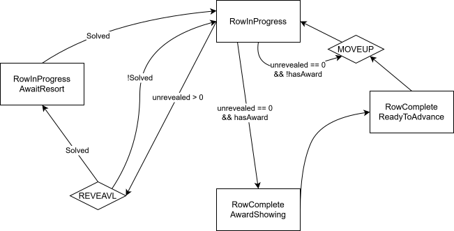

# Pyrite
A fast, memory-efficient ICPC contest resolver for DomJudge.
Created after being thoroughly tortured by the ICPC Tool.
> [!IMPORTANT]
> This program is still experimental. Use it in production at your own risk.  
> Has been tested on **ICPC 2026 Xi'an Invitation Contest**.

## Usage
First, download the binary from the Releases page. It is fully self-contained and can be run directly.  
The program requires a **CDP (Contest Data Path)** to operate. An example directory structure is shown below:
```
.
├── affiliations
│   ├── INST-001.jpg
│   ├── ....
│   └── INST-235.jpg
├── config.toml
├── event-feed.ndjson
└── teams
    ├── team002.jpg
    ├── ....
    └── team417.jpg
```
Use the GUI to set the CDP path. The program will automatically validate the structure and parse the event feed.

> [!TIP]  
> The `config.toml` file is optional. It can be used to customize behavior and apply post-processing to the event feed (for example, to fix malformed data). If you need additional post-processing features, please open an issue.

Next, configure the awards in the GUI. The `Gold`, `Silver`, and `Bronze` medal-winning teams will be visualized for review. Make sure to double-check everything before proceeding, once the presentation starts, it cannot be undone.

> [!NOTE]  
> The selected categories will also be used during the resolver presentation. Be sure to uncheck groups such as `Star` if they should not be included.

When the resolver presentation is running:

* Press `F12` to toggle full screen.
* Press `Space` or left-click to advance the resolution process.

To reveal medals in batches with one click per batch, add these settings to the CDP's `config.toml`:

```toml
[presentation]
skip_no_medal = true
auto_advance_enabled = true
auto_advance_interval_seconds = 1.0
auto_advance_award_interval_seconds = 5.0
# Optional: show the collective award page after each batch (default: false).
batch_award_page_enabled = true
batch_name_scroll_cycle_seconds = 30.0
```

The batch size is set per award, not globally: set a positive batch size on the gold, silver, and bronze medals in the "Set Medal" stage (or in `awards.json` as each award's `batch_size` field). An award with no batch size (or `0`) is shown one recipient at a time instead of being grouped.

The presentation waits for a click or `Space` before each batch. It then resolves submissions, updates rankings, and shows each team's award page automatically. Only teams receiving a bronze, silver, or gold medal whose award has a positive batch size count toward the batch size; extra awards for the same team do not add to the count. Both the GUI's IDs (`medal-bronze`, `medal-silver`, `medal-gold`) and DOMjudge's IDs (`bronze-medal`, `silver-medal`, `gold-medal`) are recognized. GUI medal assignments take precedence for each tier when both forms exist. Teams without pending submissions still receive their awards.

An award without a positive batch size — such as champion/runner-up/third place (the top three medalists) or best-female-team — is presented one recipient at a time and is never grouped. If a team holds both a grouped medal and one of these non-grouped awards, the non-grouped award wins and that team is shown individually instead of joining the medal batch.

With `skip_no_medal = true`, ranks below the last medal recipient in the final standings are resolved silently before the presentation starts. The scoreboard keeps all teams, with focus starting at the last medal rank. Without this setting, resolution starts at the lowest row with pending submissions or an award.

`auto_advance_interval_seconds` controls ordinary resolution steps. `auto_advance_award_interval_seconds` controls how long each team's photo and award page stays fully visible after the fade-in (default: 5 seconds). The last award page of a batch also uses this interval, then closes automatically so the presentation pauses on the scoreboard, or on the collective award page when enabled.

Batch endpoints are calculated when the presentation launches, using the current medal assignments (including a reloaded `awards.json`) and final standings, from the lowest rank upward within each tier. Each batch pauses when the requested number of medals has been shown **or that medal tier is finished**, whichever comes first. For example, 23 bronze recipients with a batch size of 12 produce batches of 12 and 11. By default, each batch pauses on the scoreboard, and the next click starts the next batch. Silver starts with a fresh count.

Set `batch_award_page_enabled = true` to show a collective award page at each batch boundary. It defaults to `false` and requires `auto_advance_enabled = true` with at least one medal tier having a positive batch size. Omitting it or setting it to `false` keeps the scoreboard pause and does not change medal batch counting.

The optional collective award page shows the actual recipients of that batch in reveal order, with circular school logos and team photos on either side of a wide name list. Names use large text and natural line heights without shrinking to fit the column, with a thin divider after each complete name. When the list fits, it stays centered and still; when it overflows, it pauses for two seconds before scrolling upward in a continuous loop. Each new batch starts from the first name. The side columns contain no text, and the middle has no medal or team-count heading. Photos have no background fill. Missing or unreadable team photos are hidden, including their frames; this page does not substitute fallback images or school logos for photos. The page fades in and out over 350 ms. The next click fades it out, then returns to the scoreboard and starts the next batch. After the final batch, clicking fades back to the completed scoreboard. Additional clicks during a transition or a running batch are ignored.

If no award has a positive batch size, the existing automatic mode is preserved, which pauses at every award page. Setting `auto_advance_enabled = false` keeps manual stepping.

`batch_name_scroll_cycle_seconds` sets the time for one complete loop of all names on the collective award page (default: 30 seconds, range: 0.1–3600 seconds). The scroll speed is the measured height of one complete name list divided by this duration, including wrapped lines, dividers and spacing. The initial two-second pause is separate. A larger value scrolls more slowly; lists that fit stay still.

Animation speed is configured in the `config.toml` file and cannot be changed during the presentation. Be sure to test everything beforehand.

Main logic is shown as following state machine.



## Build

### Windows Native AOT static linking

For a fully static Windows AOT build, first place the required static libraries inside the `Native` directory:

* [https://github.com/2ndlab/ANGLE.Static](https://github.com/2ndlab/ANGLE.Static)
* [https://github.com/2ndlab/SkiaSharp.Static](https://github.com/2ndlab/SkiaSharp.Static)

The expected files are:

```text
Native\libHarfBuzzSharp.lib
Native\skia.lib
Native\SkiaSharp.lib
Native\av_libglesv2.lib
```

Then uncomment the `ItemGroup` labeled `ImportLib` in `Pyrite.csproj` so the AOT publish can link these libraries through `DirectPInvoke` / `NativeLibrary`.

From a Windows PowerShell terminal, run:

```powershell
dotnet publish .\Pyrite.csproj -c Release -r win-x64 -p:PublishAot=true --self-contained true
```

To publish into a fixed output directory, run:

```powershell
dotnet publish .\Pyrite.csproj -c Release -r win-x64 -p:PublishAot=true --self-contained true -o .\out\win-x64-aot
```

`Pyrite.csproj` already sets `PublishAot` to `true`, but keeping `-p:PublishAot=true` in the command makes the release intent explicit. The published executable will be under the selected output directory, or under `bin\Release\net10.0\win-x64\publish` when `-o` is not specified.
